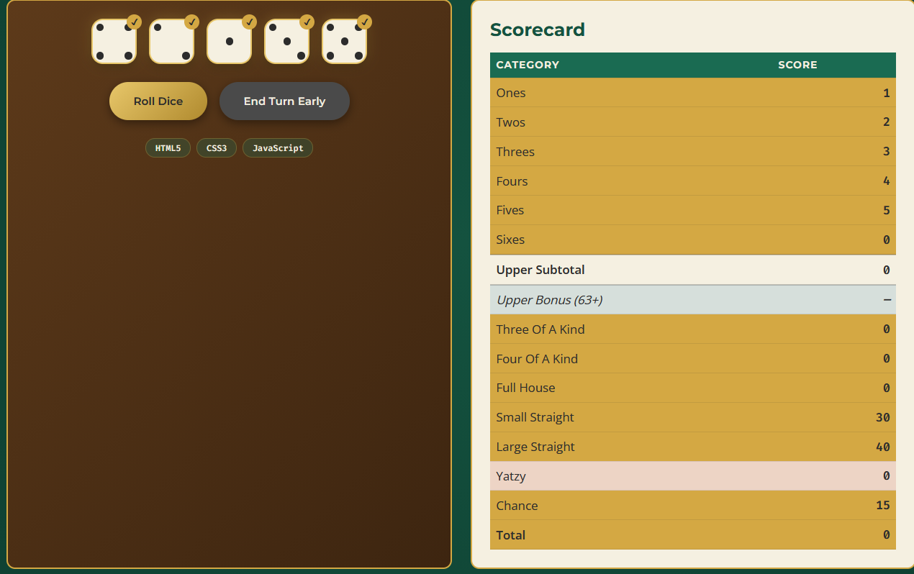
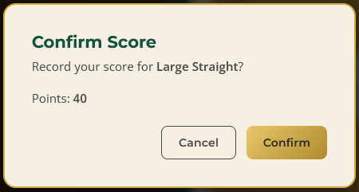
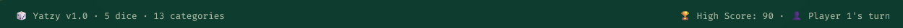
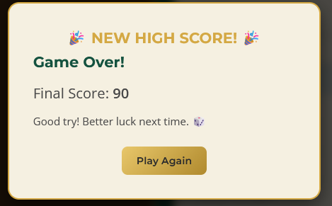

# Yatzy Game

A browser-based implementation of the classic dice game **Yatzy** (also known as Yahtzee). Players roll five dice up to three times per turn, aiming to score the highest total by matching specific combinations. The game features a classic casino/tabletop aesthetic with modern digital UI elements, animations, and responsive design.

## Rules

1. Each player takes turns rolling five six-sided dice.
2. On a turn, you may roll the dice up to **three times**. After each roll, you may set aside any dice you want to keep and re-roll the rest.
3. After your final roll, you must choose a **category** on the scorecard to record your score. Each category can be used only once per game.
4. **Upper section** (Ones, Twos, Threes, Fours, Fives, Sixes): Score the sum of dice showing that number.
5. **Lower section**:
   - **Three of a Kind**: Sum of all dice if at least three show the same number.
   - **Four of a Kind**: Sum of all dice if at least four show the same number.
   - **Full House**: 25 points for three of one number and two of another.
   - **Small Straight**: 30 points for four consecutive numbers (1-2-3-4, 2-3-4-5, or 3-4-5-6).
   - **Large Straight**: 40 points for five consecutive numbers (1-2-3-4-5 or 2-3-4-5-6).
   - **Yatzy**: 50 points for five of a kind.
   - **Chance**: Sum of all five dice.
6. **Bonus**: If the upper section total is 63 or more, add 35 bonus points.
7. The player with the highest total score at the end wins.

## Tech Stack

### Client-Side
- HTML5
- CSS3
- JavaScript (ES6+)
- Fetch API (Assignment 2)

### Server-Side (Assignment 2)
- Node.js
- Express.js

---

## Lab 07 — UI Integration & Controller

Lab 07 focused on bridging the gap between the backend logic modules (created in Lab 06) and the user interface (designed in Lab 05). A fourth module, `app.js`, was introduced to act as the UI Controller. It handles event listeners, DOM manipulation, and rendering state based on the underlying data modules.

### Design Decisions (Lab 07)

- **5 dice**, 6-sided — classic Yatzy.
- **13 scoring categories** (6 upper + 7 lower).
- **3 rolls per turn**, with hold/re-roll support.
- **Single-player** — Focused on the core assignment requirement.
- **63+ upper bonus = 35 points** — standard rule.
- **Local Storage** — Utilized to save and track the highest score across sessions.
- **Separation of Concerns** — The UI (`app.js`) is completely decoupled from the game rules (`yatzyEngine.js`) and state (`yatzyGame.js`).

### Project Architecture (Lab 07)

The project is divided into four distinct modules to ensure clean, maintainable code:

| Module | File | Responsibility |
|--------|------|----------------|
| **UI Controller** | `app.js` | DOM manipulation, event handling, rendering the UI |
| **Game State** | `yatzyGame.js` | Game flow, turns, rounds, player tracking |
| **Scoring Engine** | `yatzyEngine.js` | Rules, score calculation, validation, score table |
| **Dice** | `dice.js` | Random number generation, tracking held dice |

---

## Assignment 2 — Server-Side Integration (Node.js + Express)

Assignment 2 involved migrating the game from a client-side application to a full-stack application. The goal was to shift the state management and rule calculation to a server, using the Fetch API on the client to communicate.

### Architecture & Enhancements

The game was completely refactored to decouple the frontend from the backend.

- **Decoupled Architecture:** Frontend (HTML/CSS/JS) and backend (Node/Express) are completely separated. The client is now a "dumb terminal" that only renders UI.
- **Server-Authoritative State:** Dice rolls, category validation, and score calculations are strictly handled on the server to prevent cheating. Game state is held in memory in a `Map` on the server.
- **Stateless Logic:** The `yatzyEngine.js` was refactored to be completely stateless. Instead of storing scores internally, it receives a `scoreTable` and returns a calculation. This ensures the server can handle multiple concurrent games without data collisions.
- **Fetch API:** The client uses `async/await` and `fetch()` to send requests and render JSON snapshots of the game state returned by the server. 

### API Endpoints

| Method | Endpoint | Body | Description |
| :--- | :--- | :--- | :--- |
| `POST` | `/api/game` | `{ "players": ["Player 1"] }` | Creates a new game session and returns the initial state. |
| `GET` | `/api/game/:id` | *None* | Fetches the current state of a specific game. |
| `POST` | `/api/game/:id/roll` | *None* | Rolls non-held dice and returns the new state. |
| `PUT` | `/api/game/:id/hold` | `{ "index": 2 }` | Toggles the hold status of a specific die. |
| `POST` | `/api/game/:id/score` | `{ "category": "ones" }` | Records a score, validates it, and advances the turn. |

### How to Run (Assignment 2)

1. Clone the repository and navigate to the `assignment2` directory.
2. Install dependencies: `npm install`
3. Start the server: `npm start`
4. Open your browser to: `http://localhost:3000`

---

## 📸 Screenshots

Here is a visual overview of the final Yatzy game:

**Game Board & Dice Tray**


**Scorecard Preview (Checking potential scores)**


**Confirming a Score**


**End Game & High Score Tracking**


---

## Module API Overview

### Server-Side

#### `server.js` (Game State Machine)
| Function | Description |
|----------|-------------|
| `createGame(players)` | Initializes a new game session |
| `snapshot(state)` | Returns a safe JSON object for the client |
| `rollDice(state)` | Rolls non-held dice |
| `toggleHold(state, index)` | Toggles the hold state of a die |
| `scoreTurn(state, category)` | Records a score and advances the turn |

#### `yatzyEngine.js` (Stateless Scoring)
| Function | Description |
|----------|-------------|
| `calculateScore(category, diceValues)` | Returns the score for a category |
| `getTotalScore(scoreTable)` | Total score incl. upper bonus |
| `isScorecardComplete(scoreTable)` | True when all 13 categories are filled |

### Client-Side

#### `app.js` (Fetch Controller - Assignment 2)
| Function | Description |
|----------|-------------|
| `createGame()` | POSTs to the server to start a new session |
| `doRoll()` | Triggers the dice animation and POSTs to `/roll` |
| `toggleHold(index)` | PUTs the die index to `/hold` |
| `scoreCategory(category)` | POSTs the category to `/score` |
| `render()` | Renders the DOM based on the server's JSON response |

---

## Usage

### Lab 07 (Client-Side Only)
To run the original client-side version, run in console:
```bash
npx http-server
```
The HTML must load the modules in the correct order (logic first, UI controller last):
```html
<script src="js/dice.js"></script>
<script src="js/yatzyEngine.js"></script>
<script src="js/yatzyGame.js"></script>
<script src="js/app.js"></script>
```

## Assignment 2 (Full Stack)
Use npm start to run the Express server, as detailed in the "How to Run" section above.

---

### 2. Updated `# 🎲 Yatzy Game — Assignment 2 (Node.js + Express).md`
*This file stays inside your `assignment2` folder as the specific README for that submission.*

*(This file remains largely the same as the one you provided, but I added a "Key Enhancements" section to explicitly hit your grading criteria).*

```markdown
# 🎲 Yatzy Game — Assignment 2 (Node.js + Express)

## Overview
This project enhances the classic Yatzy game by migrating all game logic and state management from the client-side browser to a Node.js and Express server. The frontend now acts purely as a presentation layer, communicating with the server via asynchronous Fetch API requests.

## 🚀 Setup & Installation
1. Clone the repository and navigate to the `assignment2` directory.
2. Install dependencies: `npm install`
3. Start the server: `npm start`
4. Open your browser to: `http://localhost:3000`

## 🏗️ Architecture & Enhancements
- **Decoupled Architecture:** Frontend (HTML/CSS/JS) and backend (Node/Express) are completely separated. The server serves the static files.
- **Stateless Logic:** The `yatzyEngine.js` was refactored to be stateless, ensuring the server can handle multiple concurrent games without data collisions.
- **Server-Authoritative State:** Dice rolls, category validation, and score calculations are strictly handled on the server to prevent cheating.
- **Fetch API:** The client uses `async/await` and `fetch()` to send requests and render JSON snapshots of the game state.
- **Optimistic UI Animations:** The client triggers a CSS dice-rolling animation while waiting for the server's asynchronous response, creating a smooth user experience despite the network delay.

## 🔌 API Endpoints
| Method | Endpoint | Body | Description |
| :--- | :--- | :--- | :--- |
| `POST` | `/api/game` | `{ "players": ["Player 1"] }` | Creates a new game session and returns the initial state. |
| `GET` | `/api/game/:id` | *None* | Fetches the current state of a specific game. |
| `POST` | `/api/game/:id/roll` | *None* | Rolls non-held dice and returns the new state. |
| `PUT` | `/api/game/:id/hold` | `{ "index": 2 }` | Toggles the hold status of a specific die. |
| `POST` | `/api/game/:id/score` | `{ "category": "ones" }` | Records a score, validates it, and advances the turn. |

## 📂 Code Organization
- `index.js`: Express server setup, API routing, and static file serving.
- `server.js`: Core game state machine and turn logic.
- `Lab-7/js-lab7/yatzyEngine.js`: Stateless scoring and rule validation.
- `Lab-7/js-lab7/app.js`: Client-side Fetch API controller and DOM renderer.