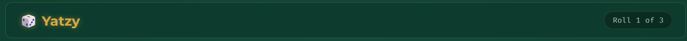
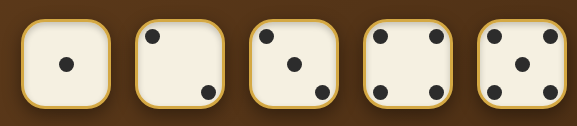
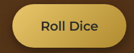
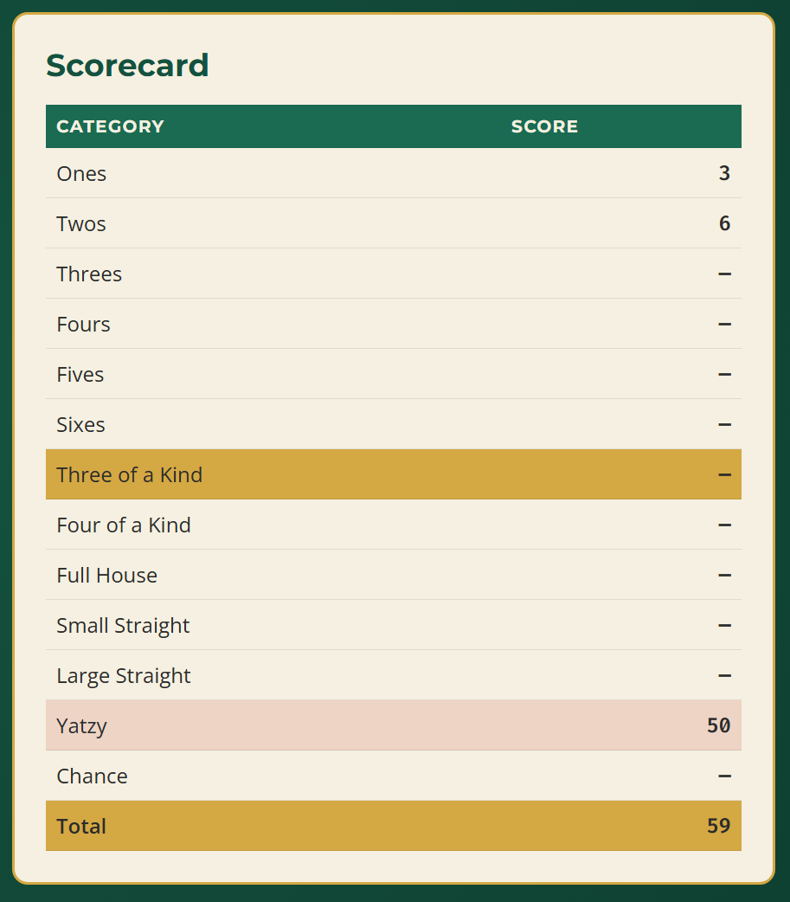
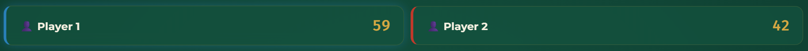
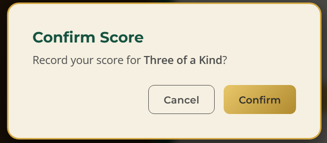
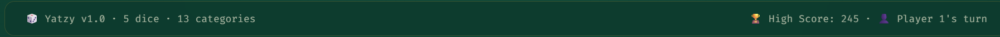
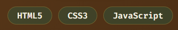
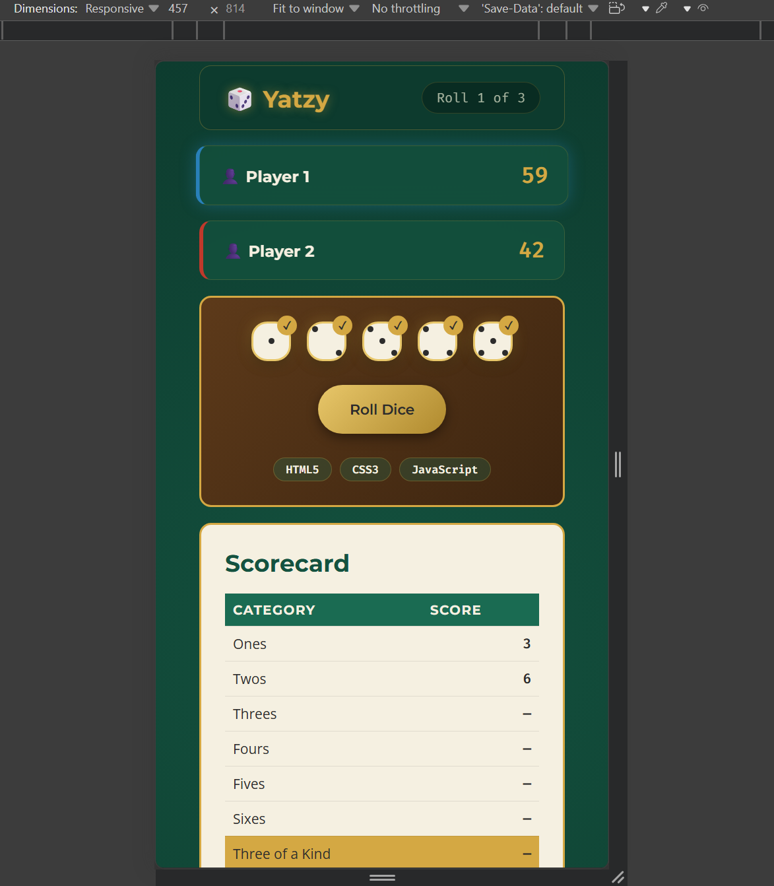

# 🎨 Design System — Yatzy Game

> **Course:** CST3106 — Lab 05
> **Author:** Reece Hannah
> **Project:** Yatzy Game (Classic Dice Game)
> **Last Updated:** 2026

---

## 1. Overview

The Yatzy Game is a browser-based implementation of the classic dice game, built with **vanilla HTML, CSS, and JavaScript**. The visual identity fuses two themes:

- 🎲 **Classic Casino / Tabletop** — felt green surfaces, warm wood accents, gold trim
- ⚡ **Modern Digital** — clean flat design, subtle shadows, smooth animations

This document defines the **design tokens, typography, components, layouts, and responsive behavior** used throughout the project.

---

## 2. Color Palette

All colors are stored as CSS custom properties (variables) in `:root` inside `style.css`.

### 2.1 Core Backgrounds (Table Layer)

| Token | Hex | Usage |
|-------|-----|-------|
| `--felt-dark` | `#0d3b2e` | Deepest background (body) |
| `--felt` | `#14523f` | Main game table surface |
| `--felt-light` | `#1a6b52` | Lighter panels, hover states |
| `--felt-highlight` | `#2d8a6e` | Accent surfaces, active areas |

### 2.2 Primary Accents

| Token | Hex | Usage |
|-------|-----|-------|
| `--gold` | `#d4a843` | Primary accent, buttons, borders |
| `--gold-light` | `#e8c76a` | Hover states, highlights |
| `--gold-dark` | `#b08a2e` | Pressed states, depth |
| `--cream` | `#f5f0e1` | Dice background, cards |

### 2.3 Secondary Accents

| Token | Hex | Usage |
|-------|-----|-------|
| `--red` | `#c0392b` | Score highlights, "Yatzy" category |
| `--red-light` | `#e74c3c` | Hover on red elements |
| `--blue` | `#2980b9` | Player 2 indicator, info |
| `--blue-light` | `#3498db` | Hover on blue elements |

### 2.4 Structural (Wood & Stone)

| Token | Hex | Usage |
|-------|-----|-------|
| `--wood` | `#5d3a1a` | Wooden trim, dice tray border |
| `--wood-light` | `#7a4e25` | Lighter wood accents |
| `--stone` | `#2c2c2c` | Dark borders, text on light |
| `--stone-light` | `#4a4a4a` | Muted borders |

### 2.5 Text Colors

| Token | Hex | Contrast on `#0d3b2e` | WCAG |
|-------|-----|----------------------|------|
| `--text` | `#f5f0e1` | 12.8:1 | ✅ AAA |
| `--text-muted` | `#a8b5a0` | 6.2:1 | ✅ AA+ |
| `--text-dark` | `#1a1a1a` | — | For light backgrounds |

### 2.6 Palette Reference

- [W3Schools CSS Colors](https://www.w3schools.com/css/css_colors.asp)
- [Coolors Palette Generator](https://coolors.co/)

---

## 3. Typography

### 3.1 Font Families

| Token | Stack | Purpose |
|-------|-------|---------|
| `--font-display` | `'Montserrat', 'Helvetica Neue', sans-serif` | Headings, game title, scores |
| `--font-body` | `'Open Sans', -apple-system, sans-serif` | Body text, descriptions |
| `--font-mono` | `'Fira Code', 'Courier New', monospace` | Score numbers, dice values, labels |

Loaded from **Google Fonts**:

```html
<link href="https://fonts.googleapis.com/css2?family=Fira+Code:wght@400;500;600&family=Montserrat:wght@600;700;800&family=Open+Sans:wght@400;500;600&display=swap" rel="stylesheet">
```

### 3.2 Type Scale

| Style | Size | Weight | Font | Usage |
|-------|------|--------|------|-------|
| Display | 3rem | 800 | display | Game title (h1) |
| H2 | 2rem | 700 | display | Section headers |
| H3 | 1.25rem | 700 | display | Card titles, player names |
| Body | 1rem | 400 | body | Paragraphs, rules |
| Body SM | 0.875rem | 400 | body | Descriptions, help text |
| Caption | 0.75rem | 500 | mono | Meta info, roll counts |
| Score | 1.5rem | 600 | mono | Dice values, total scores |
| Label | 0.7rem | 600 | mono | Category labels, tags |
| Button | 0.9rem | 600 | display | Button text |

### 3.3 Typography Reference

- [W3Schools CSS Fonts](https://www.w3schools.com/css/css_font.asp)
- [Google Fonts](https://fonts.google.com/)

---

## 4. Spacing Scale

| Token | Value | Usage |
|-------|-------|-------|
| `--space-1` | 0.25rem | Tight gaps (pip spacing) |
| `--space-2` | 0.5rem | Icon gaps, small padding |
| `--space-3` | 0.75rem | Button padding-y |
| `--space-4` | 1rem | Standard padding, gaps |
| `--space-5` | 1.25rem | Card padding |
| `--space-6` | 1.5rem | Section padding, dice tray |
| `--space-7` | 2rem | Section margins, grid gaps |
| `--space-8` | 2.5rem | Large section gaps |
| `--space-9` | 3rem | Hero/header padding |
| `--space-10` | 4rem | Major layout separation |

---

## 5. Border Radius

| Token | Value | Usage |
|-------|-------|-------|
| `--radius-sm` | 4px | Small elements, tags |
| `--radius-md` | 8px | Buttons, inputs |
| `--radius` | 12px | Cards, panels |
| `--radius-lg` | 16px | Dice, large cards |
| `--radius-pill` | 50px | Pill buttons, badges |
| `--radius-full` | 50% | Pips, avatar circles |

---

## 6. Shadows & Glows

| Token | Value | Usage |
|-------|-------|-------|
| `--shadow-sm` | `0 2px 4px rgba(0,0,0,0.3)` | Subtle depth |
| `--shadow` | `0 4px 12px rgba(0,0,0,0.4)` | Cards, dice |
| `--shadow-lg` | `0 8px 24px rgba(0,0,0,0.5)` | Modals, overlays |
| `--glow-gold` | `0 0 15px rgba(212,168,67,0.4)` | Active dice, selected |
| `--glow-red` | `0 0 15px rgba(192,57,43,0.4)` | Yatzy celebration |
| `--glow-blue` | `0 0 15px rgba(41,128,185,0.4)` | Player 2 active |
| `--inner-shadow` | `inset 0 2px 4px rgba(0,0,0,0.2)` | Dice recess, input |

---

## 7. Motion & Animation

| Token | Value | Usage |
|-------|-------|-------|
| `--ease-bounce` | `cubic-bezier(0.175, 0.885, 0.32, 1.275)` | Dice roll, button press |
| `--ease-smooth` | `cubic-bezier(0.4, 0, 0.2, 1)` | Standard transitions |
| `--ease-snap` | `0.15s` | Quick feedback |
| `--ease-normal` | `0.3s` | Standard transitions |
| `--ease-slow` | `0.6s` | Page transitions |
| Dice Roll | 0.5s | Rotation + scale |
| Dice Bounce | 0.3s | Landing effect |
| Score Pop | 0.4s | Score number scale |
| Turn Transition | 0.5s | Fade between players |
| Yatzy Celebration | 2s | Confetti, glow pulse |
| Button Hover | 0.2s | Lift + glow |

---

## 8. Components

### 8.1 Header / Game Bar



- **Background:** Frosted glass (`rgba(13,59,46,0.85)` + `backdrop-filter: blur(12px)`)
- **Border:** 1px gold (30% opacity), 12px radius
- **Layout:** Flexbox — logo left, player info center, settings right
- **Logo:** Display font, gold with subtle glow, 🎲 icon
- **Player Indicator:** Mono font, pill badge with player color
- **Roll Counter:** Mono font, muted color, "Roll 1 of 3"

**States:**

| State | Behavior |
|-------|----------|
| Default | Muted text, no underline |
| Hover | Gold text, subtle glow |
| Active Turn | Pulsing glow in player color |
| Mobile ≤768px | Stacked layout, smaller text |

### 8.2 Dice Tray



- **Layout:** Flexbox row, centered, wrap on mobile
- **Background:** Wood texture (`--wood` with subtle gradient)
- **Border:** 2px gold, 12px radius
- **Padding:** 1.5rem
- **Dice:** 60px × 60px, cream background, rounded 16px
- **Pips:** 10px circles, stone color, CSS Grid positioned
- **Shadow:** `--shadow` + `--inner-shadow` for depth

**Dice States:**

| State | Style |
|-------|-------|
| Default | Cream, stone pips, subtle shadow |
| Hover | Scale 1.05, gold glow |
| Held | Gold border, gold glow, checkmark badge |
| Rolling | Rotation animation, blur |
| Landing | Bounce easing |

### 8.3 Roll Button



- **Style:** Gold gradient background, dark text
- **Size:** Pill shape (50px radius), padding 1rem 2rem
- **Font:** Display font, 0.9rem, weight 600
- **Shadow:** `--shadow` + `--glow-gold` on hover

**States:**

| State | Style |
|-------|-------|
| Default | Gold gradient, dark text |
| Hover | Lighter gold, lift -2px, glow |
| Active | Darker gold, pressed down |
| Disabled | Muted gray, no pointer |

### 8.4 Scorecard



- **Layout:** Table with category rows
- **Background:** Cream (`--cream`) with subtle texture
- **Border:** 2px gold, 12px radius
- **Header:** Display font, felt green background, cream text
- **Rows:** Alternating felt-light / cream backgrounds
- **Category:** Body font, dark text
- **Score:** Mono font, bold, right-aligned
- **Active Category:** Gold background, glow, pointer cursor
- **Scored Category:** Muted, strikethrough, checkmark

**Scorecard Sections:**

| Section | Style |
|---------|-------|
| Upper (Ones–Sixes) | Standard rows |
| Lower (3K–Chance) | Standard rows |
| Yatzy | Red accent background |
| Bonus | Blue accent background |
| Total | Bold, gold background |

### 8.5 Player Panel



- **Layout:** Flex row, space-between
- **Background:** `rgba(20,82,63,0.7)` + backdrop blur
- **Border:** 1px gold (20% opacity), 12px radius
- **Padding:** 1rem
- **Player 1:** Blue accent border-left
- **Player 2:** Red accent border-left
- **Active Player:** Glow in player color, scale 1.02
- **Score:** Mono font, 1.5rem, bold

### 8.6 Category Modal (Score Selection)



- **Overlay:** `rgba(0,0,0,0.7)` + backdrop blur
- **Modal:** Cream background, gold border, 16px radius
- **Padding:** 2rem
- **Title:** Display font, felt green
- **Category Buttons:** Grid of pill buttons
- **Hover:** Gold background, lift
- **Selected:** Gold gradient, dark text

### 8.7 Footer / Status Bar



- **Layout:** Flex row, space-between
- **Style:** Mono font, 0.75rem, muted text
- **Background:** `rgba(13,59,46,0.9)` + backdrop blur
- **Border:** 1px gold (20% opacity), 12px radius
- **Content:**
  - Left: 🎲 Yatzy v1.0 · 5 dice · 13 categories
  - Right: 🏆 High Score: 245 · 👤 Player 1's turn

### 8.8 Tech Tags



```html
<span class="tech-tag">HTML5</span>
```

- 0.7rem mono font
- Felt-light background (30% opacity)
- Gold border (30% opacity)
- 50px radius, 0.25rem / 0.75rem padding
- Cream text

---

## 9. Layout System

### 9.1 Container

```css
.game-container {
  max-width: 1200px;
  margin: 2rem auto;
  padding: 0 1.5rem;
  position: relative;
  z-index: 1;
}
```

### 9.2 Background Layers (Z-Index Stack)

| Layer | Class | z-index | Effect |
|-------|-------|---------|--------|
| 1 (bottom) | `.felt-bg` | -2 | Felt texture, radial gradients |
| 2 | `.vignette` | -1 | Dark edge vignette |
| 3 | `.particles` | -1 | Floating gold dust particles |
| 4 | `.game-container` | 1 | All content |

### 9.3 Grid System

- **Main Layout:** `grid-template-columns: 1fr 1fr` (dice tray | scorecard)
- **Dice Row:** `flex` with gap
- **Scorecard:** `table` with fixed layout
- **Player Panel:** `flex` row

### 9.4 Game Board Layout

```
┌─────────────────────────────────────────┐
│  Header: Logo | Player 1 | Roll 1/3    │
├─────────────────────┬───────────────────┤
│                     │                   │
│   Dice Tray         │   Scorecard       │
│   ┌───┐ ┌───┐      │   ┌─────────────┐ │
│   │ 1 │ │ 2 │      │   │ Ones     3  │ │
│   └───┘ └───┘      │   │ Twos     6  │ │
│   ┌───┐ ┌───┐      │   │ Threes   —  │ │
│   │ 3 │ │ 4 │      │   │ ...         │ │
│   └───┘ └───┘      │   │ Yatzy   50  │ │
│   ┌───┐            │   │ Chance   —  │ │
│   │ 5 │            │   │ Total   59  │ │
│   └───┘            │   └─────────────┘ │
│   [ Roll Dice ]    │                   │
├─────────────────────┴───────────────────┤
│  Footer: Status | High Score | Turn    │
└─────────────────────────────────────────┘
```

---

## 10. Responsive Design



| Breakpoint | Width | Changes |
|------------|-------|---------|
| **Desktop** | >1024px | Full 2-column layout, large dice, full scorecard |
| **Tablet** | ≤1024px | Dice tray and scorecard stack, 1-column |
| **Mobile** | ≤768px | Smaller dice (50px), reduced padding, stacked player panel |
| **Small Phone** | ≤480px | Dice 40px, compact scorecard, minimal padding |

```css
@media (max-width: 1024px) {
  .game-board { grid-template-columns: 1fr; }
}

@media (max-width: 768px) {
  .dice { width: 50px; height: 50px; }
  .scorecard { font-size: 0.875rem; }
  .player-panel { flex-direction: column; }
}

@media (max-width: 480px) {
  .dice { width: 40px; height: 40px; }
  .pip { width: 8px; height: 8px; }
  .game-container { padding: 0 0.75rem; }
}
```

---

## 11. Accessibility Notes

| Issue | Location | Recommendation |
|-------|----------|----------------|
| Low contrast | `--text-muted` on felt | Use for non-essential text only |
| Dice pips | Visual only | Add `aria-label` for dice values |
| Roll button | Interactive | Add `aria-live` for roll count |
| Scorecard | Table | Use proper `<table>` semantics |
| Focus states | Not defined | Add `:focus-visible` outlines |
| Reduced motion | Not handled | Add `prefers-reduced-motion` media query |
| Color blind | Player colors | Add icons/symbols alongside colors |

**Recommended additions:**

```css
:focus-visible {
  outline: 2px solid var(--gold);
  outline-offset: 2px;
  border-radius: 4px;
}

@media (prefers-reduced-motion: reduce) {
  *, *::before, *::after {
    animation-duration: 0.01ms !important;
    animation-iteration-count: 1 !important;
    transition-duration: 0.01ms !important;
  }
}
```

---

## 12. Component Reference Table

| Component | Class | File Location | Screenshot |
|-----------|-------|---------------|------------|
| Game Header | `.game-header` | style.css | `01-header.png` |
| Player Panel | `.player-panel` | style.css | `02-player.png` |
| Dice Tray | `.dice-tray` | style.css | `03-dice.png` |
| Die | `.die` | style.css | `03-dice.png` |
| Pip | `.pip` | style.css | `03-dice.png` |
| Roll Button | `.roll-btn` | style.css | `04-button.png` |
| Scorecard | `.scorecard` | style.css | `05-scorecard.png` |
| Score Row | `.score-row` | style.css | `05-scorecard.png` |
| Category Modal | `.category-modal` | style.css | `06-modal.png` |
| Status Bar | `.status-bar` | style.css | `07-footer.png` |
| Tech Tag | `.tech-tag` | style.css | `08-tags.png` |

---

## 13. References

- [Markdown Cheat Sheet](https://www.markdownguide.org/cheat-sheet/)
- [Dillinger Markdown Editor](https://dillinger.io/)
- [W3Schools CSS Colors](https://www.w3schools.com/css/css_colors.asp)
- [W3Schools CSS Fonts](https://www.w3schools.com/css/css_font.asp)
- [Google Fonts](https://fonts.google.com/)
- [Coolors Palette Generator](https://coolors.co/)
- [GitHub Docs](https://docs.github.com/en)
- Lab example: [Reece Hannah Design System](https://github.com/kvhuang23/cst3106_labs/blob/main/lab04/Reece_Hannah_design_system.md)

---

## 14. Author & License

**[Your Name]** — CST3106 Student
MIT License © 2026w 
